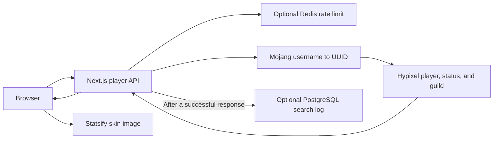

<div align="center">


# HyProgress

**Hypixel Bedwars stats, comparisons, and the XP left for your next level.**

[Website](https://hyprogress.vercel.app) · [Getting started](#getting-started) · [How it works](#how-it-works)

</div>

HyProgress turns a Minecraft username into a shareable view of public Hypixel Bedwars data. It brings lifetime performance, game-mode statistics, and a next-level estimate into one page, with a second-player comparison alongside it.

Public searches do not require an account or a Minecraft password. A separate authenticated admin page shows search activity.

## Features

| View | What it shows |
| --- | --- |
| Player overview | Calculated level, total XP, current-level progress, rank, skin, guild, online status, and available login timestamps. |
| Lifetime stats | Games played, wins/losses, kills/deaths, final kills/deaths, beds broken/lost, and WLR, KDR, FKDR, and BBLR. |
| Game modes | A collapsible breakdown for Solo, Doubles, 3v3v3v3, 4v4v4v4, and 4v4. |
| Kill Style | The four largest nonzero elimination-method counts, drawn from the returned lifetime data. |
| Next Level Goal | Remaining XP and estimated counts for the fixed XP sources defined in the application. |
| Friend comparison | Side-by-side level and performance ratios for two players. |
| Sharing and recent searches | Copyable `/player/<username>` links and up to three recent player names stored in the browser. |

A search loads a snapshot; the page does not poll for live updates. The game-mode selector changes the stats breakdown, while the level and XP goal use total Bedwars experience.

## Stack

- **Frontend:** React 19.2.8, TypeScript, Tailwind CSS 4, and Lucide icons.
- **Application server:** Next.js 16.3.3 with the App Router and a server-side player endpoint.
- **Player data:** Mojang username resolution, Hypixel player/status/guild APIs, and Statsify skin images.
- **Optional services:** PostgreSQL through `pg` for search analytics, and Upstash Redis for request limiting.
- **Admin access:** HTTP Basic Authentication, with a signed preview cookie using `jose`.

Dependency versions and scripts are defined in [package.json](package.json), with the resolved dependency tree in [package-lock.json](package-lock.json).

## Getting started

Use **Node.js 20.9.0 or later**, npm, and a Hypixel API key. PostgreSQL and Redis are optional for the public tracker.

```bash
git clone https://github.com/mr-youbella/HyProgress.git
cd HyProgress
npm ci
```

Copy the [environment template](.env.example) to `.env.local`:

```bash
cp .env.example .env.local
```

Edit `.env.local` and set `HYPIXEL_API_KEY` to your own API key. Leave the optional settings empty unless you are enabling their services.

Then start the development server:

```bash
npm run dev
```

Open [localhost:3000](http://localhost:3000), enter a Minecraft username, and select **Search**. A successful lookup updates the address to `/player/<username>`. Open the mode breakdown for detailed stats, enter another name under **You vs a Friend**, or use **Share** to copy the player link.

The server accepts names containing 1–16 letters, digits, or underscores. A resolved Minecraft account must also have Bedwars data available from Hypixel.

### Environment variables

Only `HYPIXEL_API_KEY` is needed for player lookups. Add the optional settings to the same `.env.local` file when enabling their features.

| Variable | Used for |
| --- | --- |
| `HYPIXEL_API_KEY` | Required server-side Hypixel API access. |
| `DATABASE_URL` | PostgreSQL connection string for completed-search logging and admin analytics. |
| `SUPABASE_CA_CERT` | Database CA certificate when needed for TLS verification; accepts a multiline PEM or escaped `\n` line breaks. |
| `UPSTASH_REDIS_REST_URL` | Upstash REST endpoint; used together with its token. |
| `UPSTASH_REDIS_REST_TOKEN` | Upstash REST token for rate-limit counters. |
| `ADMIN_USERNAME` | Username for `/admin`; both admin credentials must be configured to allow access. |
| `ADMIN_PASSWORD` | Password for `/admin`. |
| `ADMIN_SESSION_SECRET` | Secret for signing the one-hour admin-preview cookie. |

These settings are read on the server and do not use a `NEXT_PUBLIC_` prefix. `.env.local` is ignored by Git. Restart the development server after changing its configuration.

### Optional database setup

Apply [db/schema.sql](db/schema.sql) to your PostgreSQL database using a SQL client, or the SQL Editor when using Supabase. It creates `player_searches` with an identity ID, player name, search timestamp, and an index on the timestamp.

The connection pool verifies TLS certificates and uses the supplied CA when configured. Without `DATABASE_URL`, lookup requests still work and analytics are unavailable. Database insert/read failures are logged and handled without preventing a successful player response.

The table records lookups, not historical snapshots of player stats. No database migration or data-retention job is included.

## How it works



The endpoint validates the username, checks the request limit when Redis is configured, and resolves the username through Mojang. It then requests the Hypixel player, status, and guild data in parallel and returns the fields needed by the UI. API credentials stay in the server requests.

| Request behavior | Implementation |
| --- | --- |
| Username resolution | Mojang fetches request a 300-second revalidation interval. |
| Hypixel data | Player, status, and guild fetches request 30-second revalidation intervals. |
| Timeouts | Each upstream fetch has its own eight-second timeout. |
| Rate limit | Upstash sliding window of 20 player API requests per client IP per 60 seconds. |
| Limit response | HTTP `429` with a `Retry-After` header, which the UI uses in its error message. |
| Analytics | Successful non-preview lookups schedule a parameterized insert using Next.js `after()`. |

The IP comes from the first `x-forwarded-for` value, then `x-real-ip`, with `unknown` as a fallback. A deployment needs a trusted proxy that supplies those headers. Without Redis configuration, or when the limiter throws an error, requests proceed without enforcement. Friend lookups use the same endpoint and rate limit.

### XP calculation

[lib/bedwarsXp.ts](lib/bedwarsXp.ts) converts total XP into a level and progress within that level. The implemented costs are 500, 1,000, 2,000, and 3,500 XP for the first four levels, then 5,000 XP per level. The calculation does not repeat the early-level costs at prestige boundaries.

For example, 1,200 total XP gives level 1, with 700 of its 1,000 XP completed and 300 XP remaining. Each goal estimate is `ceil(remaining XP / XP per source)`, using constants in that file. The source rows are separate estimates, not a combined checklist or a prediction of actual match rewards. They are not fetched from an official reward-calculation endpoint.

## Routes and admin analytics

| Route | Purpose |
| --- | --- |
| `/` | Search interface, introduction, and browser-local recent searches. |
| `/player/<username>` | Loads a player's result from a shareable URL. |
| `/api/player/<username>` | JSON endpoint for player data and lookup errors. |
| `/admin` | Authenticated search analytics dashboard. |
| `/privacy` | Explanation of storage, third-party services, and admin cookies. |
| `/sitemap.xml`, `/robots.txt` | Generated public sitemap and crawler rules. |

The admin dashboard shows total searches, case-insensitive unique-player counts, searches in the last 24 hours, the latest **45** records, and up to **31** most-searched names. Missing database configuration or a failed query produces an analytics-unavailable view.

[proxy.ts](proxy.ts) protects `/admin` and its subpaths with Basic Authentication. Missing credentials deny access. With `ADMIN_SESSION_SECRET` set, successful authentication also issues an HS256-signed, HttpOnly preview cookie that expires after one hour. Valid preview requests skip search logging; they still pass through the API's rate limiter. The cookie does not replace Basic Authentication on `/admin`.

Use HTTPS when deploying Basic Authentication. The admin page is marked `noindex`, crawler rules disallow `/admin` and `/api/`, and the sitemap includes only the homepage and privacy page.

## Project structure

```text
app/
  HyprogressTracker.tsx       Search, results, comparison, and sharing UI
  page.tsx                   Home route
  player/[username]/page.tsx  Player route
  api/player/[username]/     Mojang and Hypixel lookup endpoint
  admin/page.tsx             Search analytics dashboard
  privacy/page.tsx           Privacy information
  layout.tsx                 Metadata, icons, and structured data
  not-found.tsx              Custom 404 page
  robots.ts, sitemap.ts      Crawler configuration
lib/
  bedwarsXp.ts               Level and goal calculations
  database.ts                PostgreSQL pool and analytics queries
  rate_limit.ts              Optional Upstash limiter
  admin_auth.ts              Preview-token signing and verification
db/schema.sql                Search-log schema
proxy.ts                     Admin authentication guard
public/                      Existing logo, background, manifest, and social image
```

## Checks and production

The available package scripts are:

```bash
npm run lint
npm run build
npm run start
```

`start` serves a completed production build; stop the development server first if it is using the same port. Next.js also accepts an explicit Webpack build through `npm run build -- --webpack`. No automated test script is configured in this repository.

For a manual walkthrough, search for an account with Bedwars data, open its direct URL, compare a second player, and copy the share link. Check an invalid name and a player without Bedwars data. With optional services configured, check the admin totals after a public lookup, confirm that a preview lookup is excluded, and verify a `429` response after exceeding the request window.

The site URL is currently set to `https://hyprogress.vercel.app` in [app/layout.tsx](app/layout.tsx), [app/robots.ts](app/robots.ts), and [app/sitemap.ts](app/sitemap.ts). Update those values when deploying under another domain.

---

Created by [mr-youbella](https://github.com/mr-youbella). HyProgress is an independent community project and is not affiliated with Mojang, Hypixel, or Minecraft.
